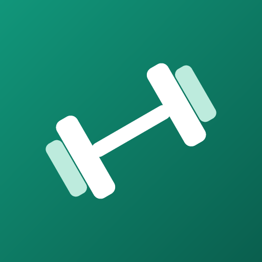

<h1>&nbsp; Daftar l-Gym</h1>

A small phone app to track the gym and food. It works offline, and all data stays on your own phone.

**Link:** https://houssam20-m.github.io/daftar-gym/

## How to install it

1. Open the link in Chrome on your phone (once, with internet).
2. The three dots at the top, "Install app" or "Add to Home screen".
3. From then on you open it from the icon, even with no internet.

## What it does

| Tab | What it does |
|---|---|
| Today | The session of the day (A, B, C or a light day). Tick the exercises, type the kg and the reps. It has a 5-minute warm-up, a rest timer (60/90/120 seconds), a streak of days in a row, a "Rest today" button that pauses the rotation without breaking it, and "Change exercise" when a machine is taken or something hurts. |
| Week | The weekly check-in: weight, sleep, energy, food. At the top: a recap of the last 7 days (weight, sessions, food, sleep) with a "Share" button, and a calorie nudge when the weight is not moving or is dropping too fast. |
| Progress | The weight chart, weekly or monthly, last 12 weeks or everything, a dashed line for the expected pace (0.75 kg a week), and the exercise progression: every exercise with its last kg x reps and a hint (add 2.5 kg / more reps / go lighter). |
| Food | Add what you ate and see calories and protein against the daily target. It has the 5 plan meals in one tap, your own food buttons (ones you save yourself), and the water counter (12 glasses = 3 L). |
| More | The report for your coach, the plan (height, goal, calories), the backup, and body photos (once a month). |

The app's main language is **English**; Darija is an option (from the top bar or from More).

Settings open from the gear at the top right of every tab: light, dark or auto, six colour themes (Khdar, Majorelle, Zafran, Ward, Zitoun, Bnafsaji), and the language (English or Darija). The week number sits in the middle under the header.

## The programme

Full body, every day split in two: legs and walking in the morning, upper body in the evening.
Order: A, B, C, A, B, C, a light day, then repeat.

| Day | Morning | Evening |
|---|---|---|
| A | Leg press, plank, walk | Chest press, lat pulldown, lateral raises |
| B | Romanian deadlift, leg curl, walk | Seated row, shoulder press, biceps curl |
| C | Goblet squat, calf raises, walk | Incline dumbbell press, cable row, triceps pushdown |
| Light | Bike or treadmill, 30 minutes | Stretching, plank |

## Goals

The setup screen works out the goal from the current and goal weight: lose, keep, or gain.

| Goal | Calories | Protein | Training |
|---|---|---|---|
| Lose | Burn minus a deficit aimed at about 0.75% of body weight a week (never more than 1 kg a week, never below 1500 kcal for men or 1200 for women) | 2.0 g per kg of goal weight | 3 x 10-12, walking 20-30 min |
| Keep | Same as the burn | 1.6 g per kg | 3 x 8-12 on the big lifts, walking 15-20 min |
| Gain | Burn plus 10% (150 to 350 kcal) | 1.8 g per kg | 4 x 6-10 on the big lifts, 3 x 10-12 on the small ones, walking 10 min |

The burn is Mifflin-St Jeor times an activity factor from the days per week (1.375 for 3 days up to 1.6 for 6-7, plus 0.1 for two sessions a day). The food tab starts empty: each person adds their own meals with calories and protein, and ticks them each day against the target.

## The data

- Everything is stored in the browser's `localStorage` on the phone. Nothing goes to any server.
- If you clear Chrome's data or change phone, it is lost. Make an "Export backup" in the More tab once a week. If 7 days pass without a backup, the app shows a banner at the top.
- "Copy report" gives you a text with the weight, the exercise weights and the food, ready to paste to your coach.
- Body photos are kept in `IndexedDB` on this phone (compressed), not in `localStorage` and not in the backup. If you change phone the photos are lost, but everything else is in the backup.
- The calorie nudge only works when there are 2 weigh-ins within 14 days. Once you accept the change, it stays quiet for 14 days.

## The files

Each part of the screen has its own file, and its code is in another file.

| Folder / file | What it is |
|---|---|
| `index.html` | Only the shell: it loads the other files in order |
| `views/` | The HTML of each part: `splash`, `setup`, `header`, `lyoum`, `simana`, `t9eddom`, `makla`, `kter`, `nav`, `photo-viewer` |
| `js/` | The code: `store` (saving), `lang` (Darija/English), `ui`, `helpers`, `stats`, `session` (the programme), `food`, `photos`, `report`, `boot` (start-up) |
| `css/` | The styles: `base`, `components`, `tools`, `progress`, `motion`, `food` |
| `sw.js` | Service worker: it is what makes the app work offline |
| `manifest.webmanifest` | Name, colours and icons for the install |
| `icon-192.png`, `icon-512.png` | The logo |

## How to change something

1. Edit the file for that part: `views/` for what a screen shows, `js/` for what it does, `css/` for how it looks.
2. If you add a new file, add it to `FILES` in `sw.js`. Then bump the number in `CACHE` (for example `daftar-gym-v13`). Without it, the phone keeps the old version.
3. `git commit` and `git push`. The phone picks up the new version the next time you open the app with internet.

The calorie numbers in the app are estimates.
